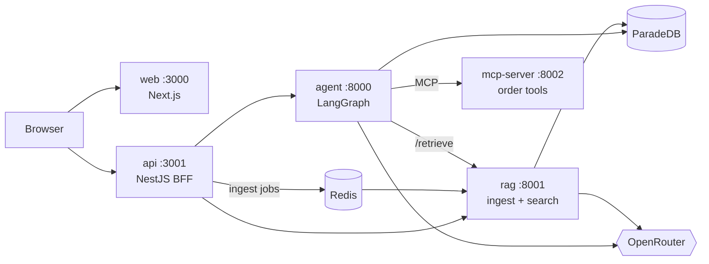

# Support desk agent

A customer support agent for a fictional store. It answers policy questions from ingested help-center documents, looks up orders through MCP tools, and drafts refunds and emails. Anything that spends money or contacts a customer pauses for a human to approve. Paused runs are checkpointed in Postgres, so a pause can last days and survive a restart.

## Architecture



| Service | Stack | Owns |
| --- | --- | --- |
| [web](docs/services/web.md) | Next.js 15 | Chat (with saved chats), Documents, Approvals (queue and decision history), and Evals pages |
| [api](docs/services/api.md) | NestJS 11 | The only browser-facing API; forwards to agent and rag; produces ingest jobs |
| [agent](docs/services/agent.md) | Python, FastAPI, LangGraph | Conversation graph, routing, human-in-the-loop pauses, checkpoints |
| [rag](docs/services/rag.md) | Python, FastAPI | Documents, parsing, chunking, embeddings, hybrid search, RAG evals |
| [mcp-server](docs/services/mcp-server.md) | TypeScript, MCP SDK | Order, customer, and refund tools over Streamable HTTP |

Postgres (ParadeDB, with pgvector and BM25) holds agent checkpoints and rag chunks in separate tables. Redis carries the ingest queue. Every model call goes through OpenRouter. LangSmith tracing is optional.

## Docs

| Folder | Contents |
| --- | --- |
| [`docs/services/`](docs/services) | One page per service: what it does, endpoints, main diagrams (including the [LangGraph](docs/services/agent.md#langgraph)), config, known gaps |
| [`docs/flows/`](docs/flows) | [Chat](docs/flows/chat.md), [human in the loop](docs/flows/human-in-the-loop.md) (refund approval and email confirmation), [document ingest](docs/flows/document-ingest.md) |
| [`docs/decisions/`](docs/decisions) | Numbered ADRs for cross-service choices, plus [service decisions](docs/decisions/service-decisions.md) |

`docs/seed/` and `docs/uploads/` are runtime data used by rag, not documentation.

## Setup

Requires Node 20+, pnpm, Python 3.11, Poetry, Docker, and an [OpenRouter](https://openrouter.ai) API key.

```bash
pnpm setup                                   # TS + Python deps, copies every .env.example
docker compose up -d postgres redis
```

Set `OPENROUTER_API_KEY` in **both** `apps/agent/.env` and `apps/rag/.env`. The agent reads only its own `.env`; rag reads the root `.env` then its own.

Load the sample policy documents, then start everything:

```bash
(cd apps/rag && poetry run rag-seed --ingest)
pnpm dev:all
```

## Try it

Open <http://localhost:3000> and send, in one chat:

1. `How long do I have to request a refund?` — answered from the policy documents.
2. `Where is order ORD-1002?` — answered with an MCP order tool.
3. `I'd like a refund for ORD-1001` — drafts a $49.99 refund and pauses.
4. Click **Review on Approvals**, choose **Approve**, and submit. The refund is posted.

Sample orders live in mcp-server memory; restart it to reset them.

## Common tasks

**Run one service.** `pnpm dev:web`, `dev:api`, `dev:mcp`, `dev:agent`, or `dev:rag`. `pnpm dev` runs only the three TypeScript services. Run Python commands from `apps/agent` or `apps/rag`.

**Health checks.** `curl localhost:<port>/health` on 3001, 8000, 8001, 8002.

**Add a policy document.** Upload a PDF, DOCX, HTML, Markdown, or text file (or a URL) on <http://localhost:3000/documents>. Re-uploading the same file name creates a new version.

**Approve from the API.** `curl -XPOST localhost:3001/approvals/<threadId> -H 'content-type: application/json' -d '{"decision":"edit","amount":30}'`. `decision` is `approve`, `edit`, or `reject`.

**Change models.** Set `CHEAP_MODEL` / `MAIN_MODEL` in `apps/agent/.env`, or `MAIN_MODEL` / `JUDGE_MODEL` / `EMBEDDING_MODEL` + `EMBEDDING_DIM` in `apps/rag/.env`, then restart. After an embedding change, run `poetry run rag-reindex` in `apps/rag`.

**Approval secret.** The agent signs refund approvals and mcp-server verifies them. To change the default, set the same `APPROVAL_SECRET` in `apps/agent/.env` and in mcp-server's process environment (it does not read `.env`).

**Evals.**

```bash
cd apps/rag && poetry run rag-seed --ingest
curl -XPOST localhost:8001/evals/run -H 'content-type: application/json' -d '{"answer":true,"judge":true}'
cd apps/agent && poetry run python evals/run_evals.py
curl -XPOST localhost:8000/evals/run -H 'content-type: application/json' -d '{"n":5,"k":5}'
```

**Tests.** `poetry run pytest` in `apps/agent` and `apps/rag`; `pnpm lint` for TypeScript.

## Known gaps

Cross-service shortcuts. Service-specific ones are listed at the end of each service page.

- **X-TD-1 (high)** — No authentication anywhere. Anyone who can reach api can approve refunds or read other threads; internal services bind `0.0.0.0`. Local use only.
- **X-TD-3** — No CI; thin test coverage, especially for the graph and the TypeScript apps.
- **X-TD-4** — No shared request/response types between TypeScript and Python services.
- **X-TD-6** — `paradedb/paradedb:latest` is unpinned.
- **X-TD-7** — Each service loads env files differently.
- **X-TD-8** — No request id propagated across services.
- **X-TD-9** — Only Postgres and Redis run in Docker; the apps run on the host.
- **X-TD-10** — No consistent timeout and retry policy between services.

When you change the code, update the matching service or flow page. Record cross-service choices as a new numbered ADR in `docs/decisions/` and service-local ones in `service-decisions.md`. Item IDs are stable; do not renumber.
