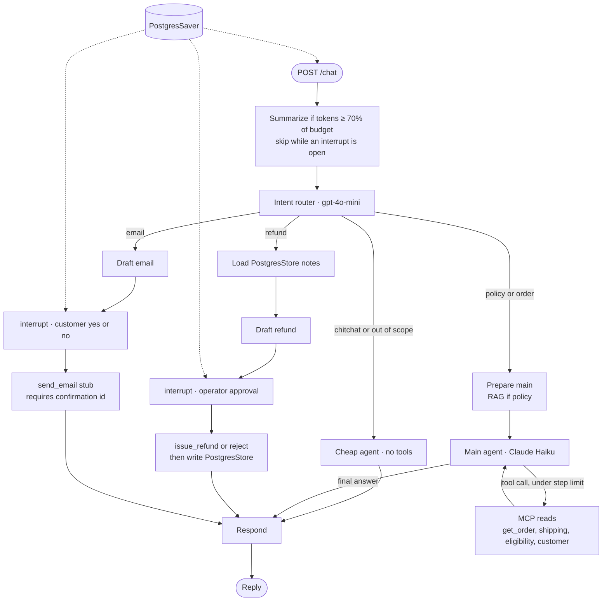

# How the agent runs

One LangGraph compiled with `PostgresSaver` (thread checkpoints) and `PostgresStore` (operator refund notes). Cheap path is `gpt-4o-mini` with no tools. Main path is Claude Haiku with MCP read tools. Write tools (`send_email`, `issue_refund`) are not bound to the model.

Source: `apps/agent/src/agent/graph/build.py`.

Resume paths:

- Email: next `POST /chat` with yes or no resumes the same thread.
- Refund: `POST /threads/{id}/resume` with approve, edit, or reject. Chat messages cannot skip the operator gate.
