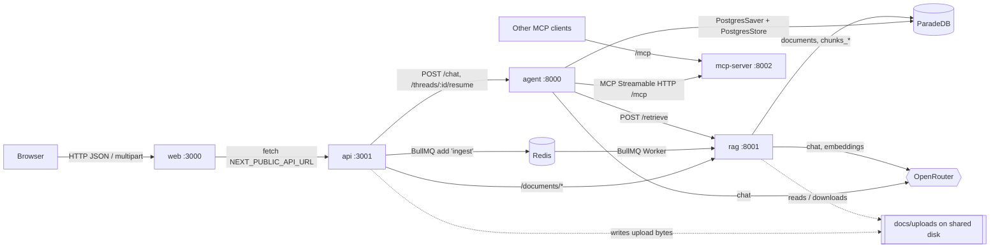
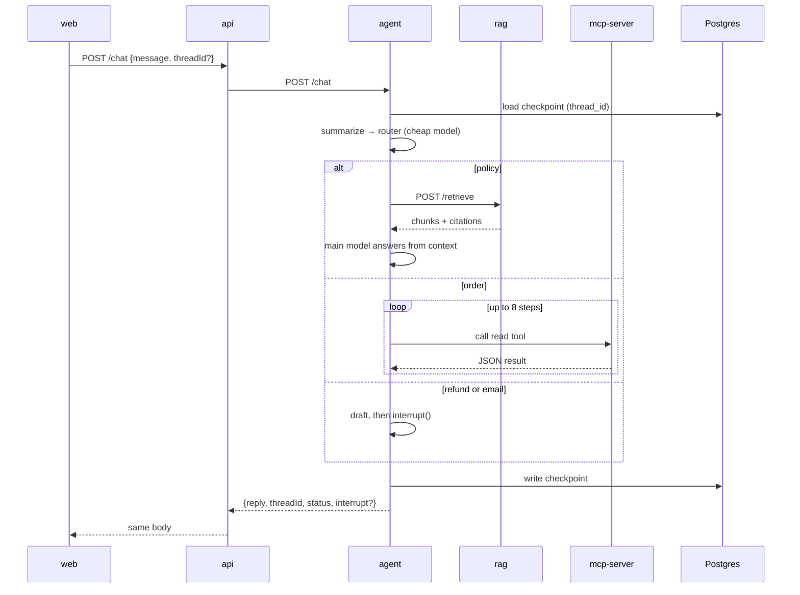

# System architecture

A customer support agent for a fictional store. It answers policy questions from ingested documents, looks up orders through MCP tools, and drafts refunds and emails that pause for a human before anything is sent or spent.

## Services

| Service | Stack | Port | Owns |
| --- | --- | --- | --- |
| [web](../services/web/README.md) | Next.js 15, React 19 | 3000 | Chat, Documents, and Approvals pages |
| [api](../services/api/README.md) | NestJS 11 | 3001 | Browser-facing HTTP, CORS, upload handling, ingest job producer |
| [agent](../services/agent/README.md) | Python, FastAPI, LangGraph | 8000 | Conversation graph, routing, HITL interrupts, checkpoints |
| [rag](../services/rag/README.md) | Python, FastAPI | 8001 | Document metadata, parsing, chunking, embeddings, hybrid search, RAG evals |
| [mcp-server](../services/mcp-server/README.md) | TypeScript, MCP SDK v2 | 8002 | Order, customer, and refund tools over Streamable HTTP |

Infrastructure (`docker-compose.yml`):

| Store | Image | Port | Used by |
| --- | --- | --- | --- |
| Postgres (ParadeDB, pgvector + pg_search) | `paradedb/paradedb:latest` | 5432 | agent (checkpoints, store), rag (documents, chunks) |
| Redis | `redis:7-alpine` | 6379 | api (BullMQ producer), rag (BullMQ worker) |

External: OpenRouter for every chat and embedding model, LangSmith for traces and eval experiments (optional).

## Service map



The browser calls `api` directly from client components. `web` has no server-side data fetching.

## Request paths

### Chat turn



### Refund approval

1. Chat routes a refund request to the refund branch. The agent drafts it from `check_refund_eligibility` and pauses with `interrupt({type: "refund_approval"})`. The checkpoint is in Postgres.
2. An operator opens `/approvals?threadId=...` and submits approve, edit, or reject.
3. `api` validates the body and calls `agent` `POST /threads/{id}/resume`.
4. The graph resumes from the checkpoint. On approve or edit it calls MCP `issue_refund` with a fresh `approval_id`. On reject it does not. Either way it appends a note to the operator memory in `PostgresStore`.

Chat messages cannot resume a refund interrupt. See [ADR 0007](decisions/0007-write-tools-gated-by-interrupt.md).

### Document ingest

1. `api` `POST /documents` takes a file or `{url}` and asks `rag` to reserve a row and a storage path.
2. `api` writes the file to that path (URL uploads are fetched later by the worker) and enqueues a BullMQ `ingest` job keyed by document id.
3. The `rag` worker parses to Markdown, chunks, embeds, and replaces the chunk rows. Status moves `queued → parsing → embedding → done | failed`.
4. `web` polls `GET /documents` every 2 s while any row is active.

Details: [rag flow](../services/rag/flow.md), [api flow](../services/api/flow.md).

## Data ownership

| Data | Owner | Location |
| --- | --- | --- |
| Conversation state, interrupts | agent | LangGraph checkpoint tables (`PostgresSaver.setup()`) |
| Operator refund notes per customer | agent | `PostgresStore`, namespace `("refunds", "operator")` |
| Document rows and versions | rag | `documents` |
| Chunks and vectors | rag | `chunks_<model>_<dim>` (one table per embedding model and dimension) |
| Uploaded and downloaded files | rag (path), api (bytes) | `docs/uploads/<slug>/v<n>/<file>` |
| Orders, customers, refunds | mcp-server | Process memory (`apps/mcp-server/src/data.ts`) |
| Ingest jobs | api (producer), rag (consumer) | Redis, queue `ingest` |

Agent and rag share one database but not tables. No service reads another service's tables.

## Configuration

Each app has `.env.example`. `pnpm env:copy` copies them, plus the root `.env.example`, without overwriting.

| Service | Env files read |
| --- | --- |
| api | `apps/api/.env`, then root `.env` |
| rag | root `.env`, then `apps/rag/.env` (later wins) |
| agent | `apps/agent/.env` only (cwd) |
| mcp-server | process env only (`PORT`, `HOST`) |
| web | `apps/web/.env.local` (`NEXT_PUBLIC_API_URL`) |

## Security model today

There is none beyond the HITL gate. No service authenticates callers, and every Python and MCP service binds `0.0.0.0`. Treat the stack as local-only. See [X-TD-1](tech-debt.md#x-td-1-no-authentication-or-authorization-anywhere).

## Running locally

```bash
pnpm setup
docker compose up -d postgres redis
pnpm dev:all      # web, api, mcp-server, agent, rag
```

## Related

- [ADR index](decisions/README.md)
- [Cross-cutting tech debt](tech-debt.md)
