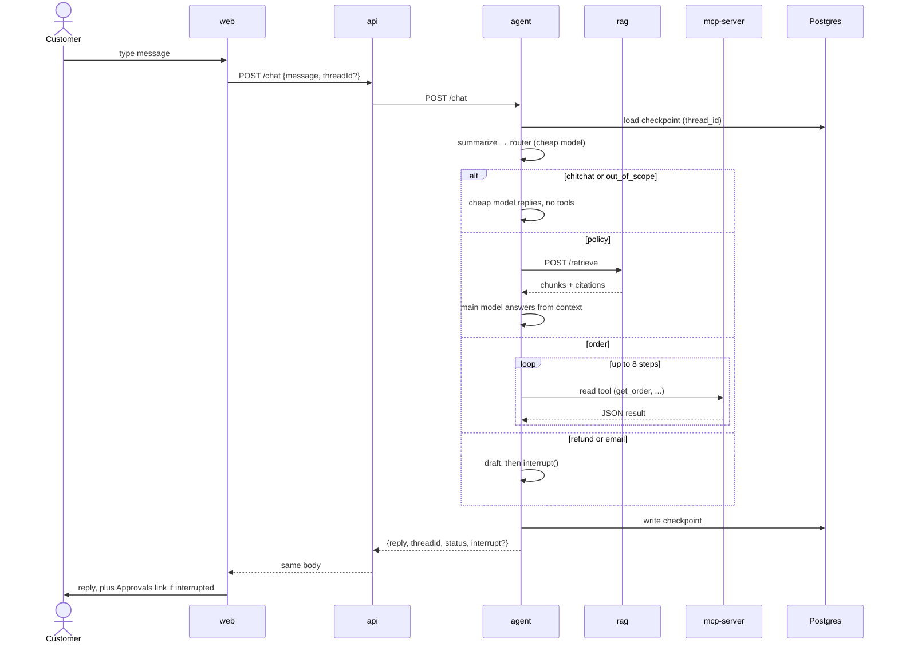
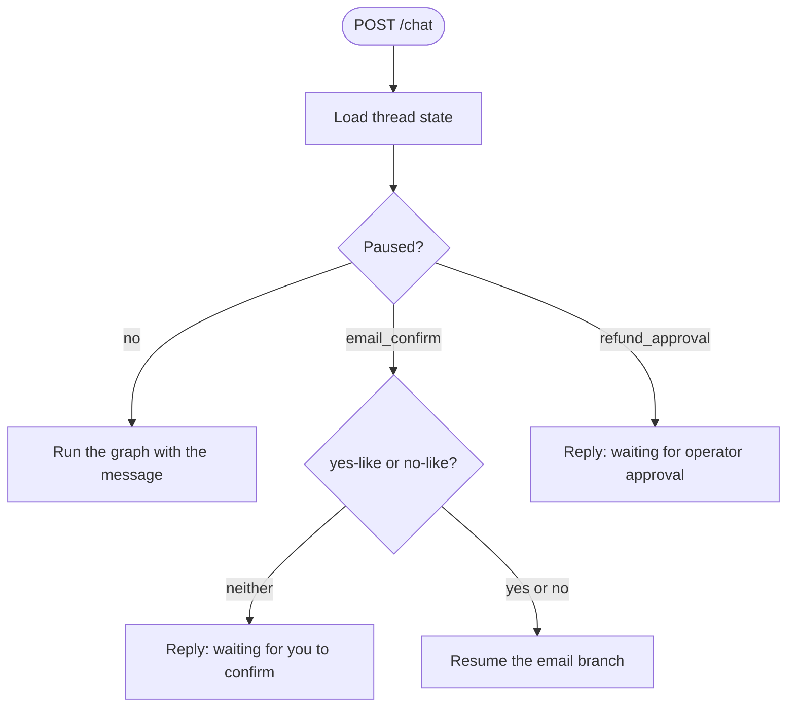

# Chat flow

How one customer message travels from the browser to the agent and back. The graph itself is on the [agent](../services/agent.md#langgraph) page. Paused runs are in [Human in the loop](human-in-the-loop.md).

## End to end

The first message sends no `threadId`; the agent creates `thread-<hex>` and every later message reuses it.

## A thread that is already paused

Before running the graph, `/chat` checks whether the thread is waiting on an interrupt:

A customer can confirm their own email, but can never resume a refund from chat. Only the operator endpoint can.

## Errors

- If the agent returns non-2xx or is unreachable, api returns 503 to the browser (including the agent's 404 and 400 on resume).
- If rag is down, the policy turn gets empty context and the model says it has no policy.
- If mcp-server is down, the tool returns `{"error": ...}` to the model, which tells the customer.
- If OpenRouter fails, the router falls back to keywords; other nodes raise and the turn fails.
