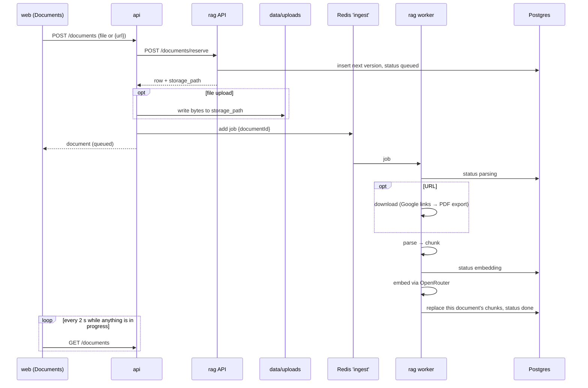

# Document ingest

How a policy document uploaded in the browser becomes searchable. Parsing, chunking, and search are on the [rag](../services/rag.md#pipeline) page.

- rag owns the document rows and storage layout; api only writes the bytes to the path rag reserved. They must share the `data/uploads` directory.
- The job id is the document id, so a repeated enqueue is a no-op. Failed jobs retry 3 times with backoff, then the row is marked `failed` with the error.
- Re-uploading the same file name or URL creates a new version; old versions stay searchable.
- `poetry run rag-seed --ingest` skips api and Redis and ingests the seed corpus directly.
