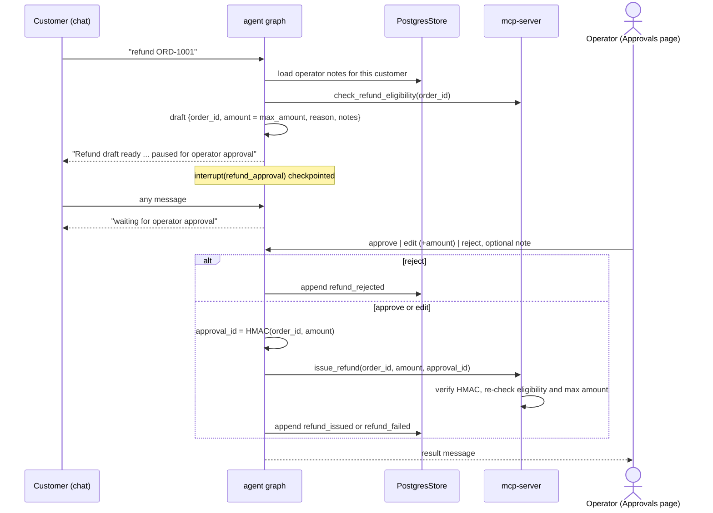
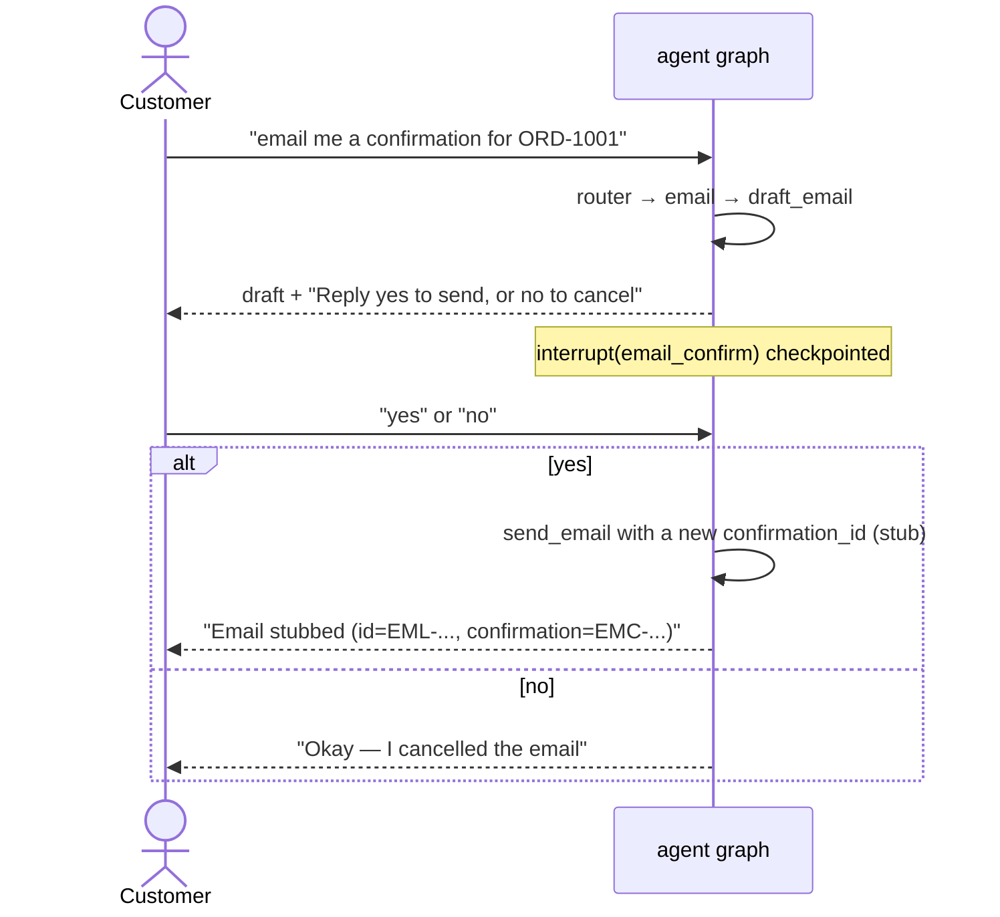

# Human in the loop

Anything that spends money or contacts a customer pauses for a human. Refunds wait for an operator; emails wait for the customer's own confirmation. The model never calls a write tool: the graph does, only after the pause resumes ([ADR 0007](../decisions/0007-write-tools-gated-by-interrupt.md)).

The pause is a LangGraph `interrupt()` saved in the Postgres checkpoint, so it can last days and survive a restart ([ADR 0008](../decisions/0008-postgres-checkpointer-and-store.md)).

## Refund approval



- An ineligible order, or one with no id, ends the turn with an explanation and never pauses.
- The operator reaches the paused thread through the chat's **Review on Approvals** link, which carries the thread id. The decision goes web → api `POST /approvals/:threadId` → agent `POST /threads/:id/resume`.
- `edit` uses the operator's amount; `approve` uses the drafted one.

### Signed approval id

The graph signs the exact order and amount right before the write, and mcp-server recomputes the signature:

```
approval_id = "APR-" + hex(HMAC-SHA256(APPROVAL_SECRET, "<order_id>:<amount in cents>"))
```

A missing id, an invented id, or a real id with a different amount all fail. Both processes must share `APPROVAL_SECRET`. mcp-server also re-runs the eligibility check and the `0 < amount ≤ max_amount` bound, so it does not depend on the agent being correct. See the guard chart on the [mcp-server](../services/mcp-server.md#issue_refund-guards) page.

### Operator memory

Each decision is appended to the customer's notes in `PostgresStore` (last 50 kept) and loaded into that customer's next refund draft, so operators see history across threads.

## Email confirmation



Yes-like replies: `yes, y, confirm, approve, send, ok, okay`. No-like: `no, n, cancel, reject, stop`. Anything else keeps waiting. `send_email` refuses any call without a `confirmation_id`, and the provider is a stub.

## Limits today

- The Approvals page shows no draft; the operator relies on the chat transcript (WEB-TD-1).
- No authentication: anyone who can reach api can approve a refund ([known gaps](../../README.md#known-gaps)).
- The signature proves the amount was approved, not who approved it (AGENT-TD-5).
