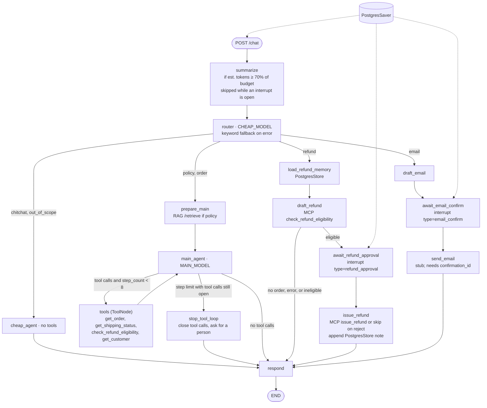
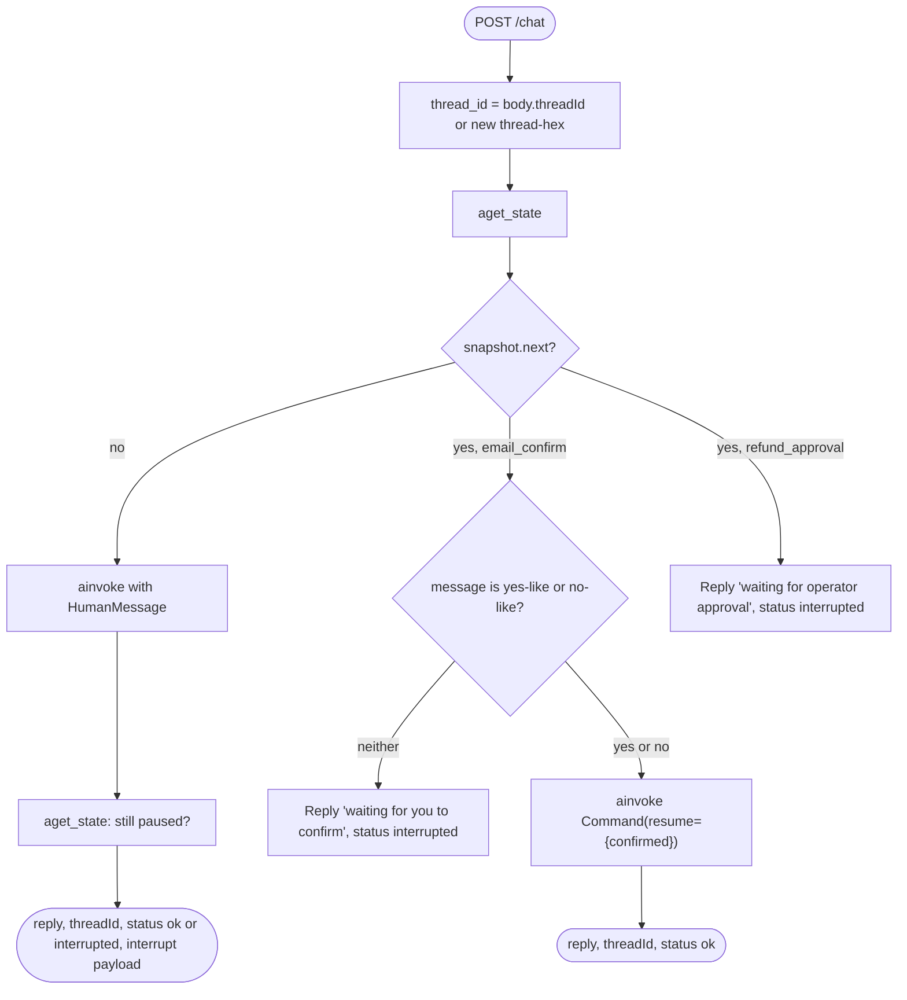
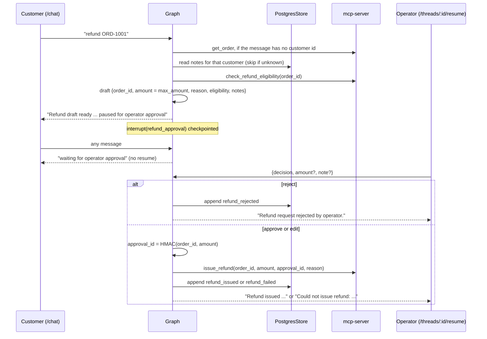

# agent flows

One graph, compiled in `graph/build.py` with `AsyncPostgresSaver` (thread checkpoints) and `AsyncPostgresStore` (operator refund notes). The cheap model has no tools. The main model is bound to MCP read tools only. Write tools (`issue_refund`, `send_email`) are called from graph nodes, never by the model.

## Graph

## `/chat` request handling

`main.py` checks for an open interrupt before running the graph:

Yes-like: `yes, y, confirm, approve, send, ok, okay`. No-like: `no, n, cancel, reject, stop`.

## Refund branch

`edit` uses the operator's `amount`; `approve` uses the drafted amount. MCP checks the HMAC, then enforces `0 < amount ≤ max_amount` and eligibility again.

No order id, an eligibility error, or an ineligible order ends the turn with an explanation. Those paths do not interrupt.

## Email branch

1. `draft_email` builds a fixed template to `customer@example.com`, mentions `order_id` if known, and asks for **yes** or **no**.
2. `await_email_confirm` interrupts with `type: email_confirm`.
3. The next `/chat` message resumes it (see above).
4. `send_email` cancels on no. On yes it mints `EMC-hex` and calls the stub, which logs and returns `status: stubbed`.

## Policy and order turns

- `prepare_main` resets `step_count` to 0. For `policy`, it sends the last human message to rag `POST /retrieve` (`top_k=5`) and stores each chunk's `embed_text` plus a metadata line in `documents`.
- `main_agent` puts the documents into the system prompt, binds the four read tools, and calls `MAIN_MODEL`. If the response has no tool calls it becomes `final_reply`.
- `ToolNode` runs the tool calls. Each MCP call opens its own Streamable HTTP session.
- `after_main` loops back while there are tool calls and `step_count < 8`. At the limit, `stop_tool_loop` writes a `ToolMessage` for each open call and sets the reply. Each turn also clears `final_reply` in the router so an older reply cannot leak through.

## Summarization

Before routing, `summarize_if_needed` estimates tokens as `len(content) // 4` per message. At or above `CONTEXT_TOKEN_BUDGET × SUMMARIZE_THRESHOLD_RATIO` (89,600 by default) and with more than `KEEP_RECENT_MESSAGES + 1` messages, it summarizes the older messages with the cheap model, removes them, and adds a `[Conversation summary]` system message. It does nothing while `interrupt_kind` is `refund` or `email`.

## Evals

| Runner | What | Needs |
| --- | --- | --- |
| `poetry run python evals/run_evals.py` | `dataset.json`: routing (via `classify_intent`), refund safety (calls MCP `issue_refund`), email safety (calls `send_email`) | Model key; MCP for refund cases with an `approval_id` |
| `POST /evals/run` | `tool_tasks.json` through the full graph, `n` runs each; checks the expected tool and args appear | Postgres, model key, MCP |
