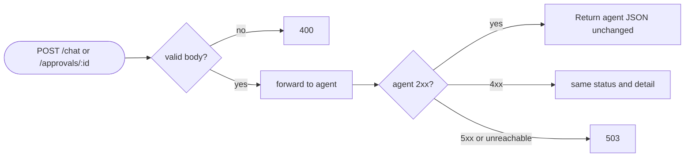

# api

NestJS backend-for-frontend on `:3001`. It is the only service the browser calls. It validates input, forwards chat and approvals to the agent, and runs the upload half of document ingest. It holds no domain logic ([ADR 0002](../decisions/0002-nest-as-thin-bff.md)).

Code: `apps/api/src/`. `agent-client.service.ts` wraps calls to the agent; `chat/` (including `threads.controller.ts`), `approvals/`, `documents/`, and `evals/` are feature modules.

## Endpoints

| Method | Path | Forwards to | Notes |
| --- | --- | --- | --- |
| GET | `/health` | — | Does not check downstreams |
| POST | `/chat` | agent `POST /chat` | 400 if `message` is blank |
| POST | `/approvals/:threadId` | agent `POST /threads/:id/resume` | `amount` required for `edit` |
| GET | `/approvals?state=pending\|decided` | agent `GET /approvals` | Approval queue and decision history |
| GET | `/threads`, `/threads/:threadId` | agent `GET /threads`, `/threads/{id}` | Saved chats; detail includes messages and approvals |
| POST | `/documents` | rag reserve, disk, Redis | Multipart `file` (≤ 20 MB) or JSON `{url}`, exactly one |
| GET | `/documents`, `/documents/:id` | rag | Mapped to camelCase |

## Forwarding and errors

Agent responses pass through unchanged, so new agent fields reach the browser without api changes. For uploads, api asks rag to reserve a row and path, writes the bytes there itself, then enqueues the ingest job ([Document ingest](../flows/document-ingest.md)).

## Config

Reads `apps/api/.env`, then the root `.env`.

| Variable | Default |
| --- | --- |
| `PORT` | `3001` |
| `WEB_ORIGIN` | `http://localhost:3000` (CORS) |
| `AGENT_URL`, `RAG_URL` | `http://localhost:8000`, `http://localhost:8001` |
| `REDIS_URL` | `redis://localhost:6379` (host and port only) |

## Known gaps

- **API-TD-1** — Uploads need a filesystem shared with rag.
- **API-TD-3** — No DTO validation pipe; `amount` is not range-checked.
- **API-TD-4** — A failed file write leaves the document stuck in `queued`.
- **API-TD-5** — No timeouts on calls to agent and rag.
- **API-TD-6** — `AgentClientService` is provided three times.
- **API-TD-7** — Config read from `process.env` and `ConfigService` inconsistently.
- **API-TD-8** — Redis URL credentials and TLS are ignored.
- **API-TD-9** — Health check does not check dependencies.

Decisions: [api](../decisions/service-decisions.md#api), [ADR 0002](../decisions/0002-nest-as-thin-bff.md).
