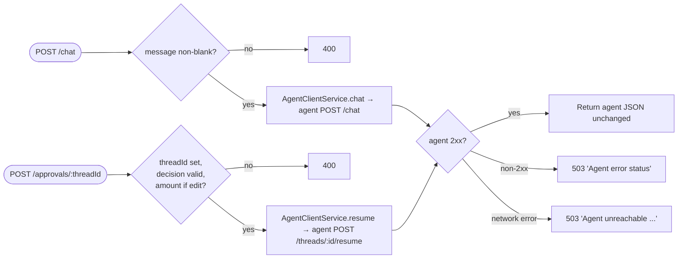

# api flows

## Chat and approvals



The agent's 404 ("No paused run") and 400 ("paused for email_confirm") on resume both reach the browser as 503.

## Document upload

```mermaid
sequenceDiagram
  participant W as web
  participant A as api
  participant R as rag
  participant D as Disk (docs/uploads)
  participant Q as Redis (ingest)
  W->>A: POST /documents (file | {url})
  A->>A: exactly one of file / url, else 400
  A->>R: POST /documents/reserve {sourceKey, filename, sourceUri}
  R-->>A: row {id, version, storage_path, status: queued}
  alt file
    A->>D: mkdir -p, write bytes to storage_path
  else url
    Note over A: no write; worker downloads later
  end
  A->>Q: add('ingest', {documentId}, {jobId: documentId})
  alt enqueue fails
    A->>R: POST /documents/:id/status {failed, error}
    A-->>W: 503 'Could not queue ingest'
  else
    A-->>W: DocumentView (status queued)
  end
```

- `sourceKey` is the original file name or the URL. The same key again gets the next version.
- For URLs, the reserved filename is `snapshot.bin`. The worker renames it once it detects the type.
- Queue options: 3 attempts, exponential backoff from 2 s, keep 100 completed and 200 failed jobs.
