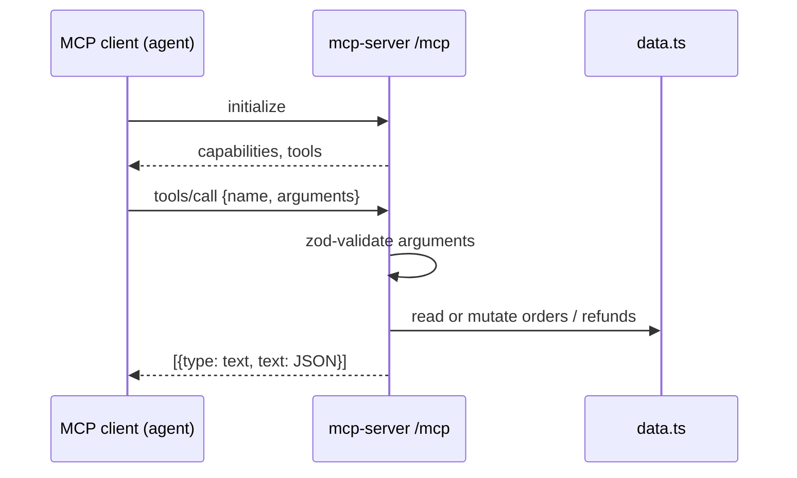
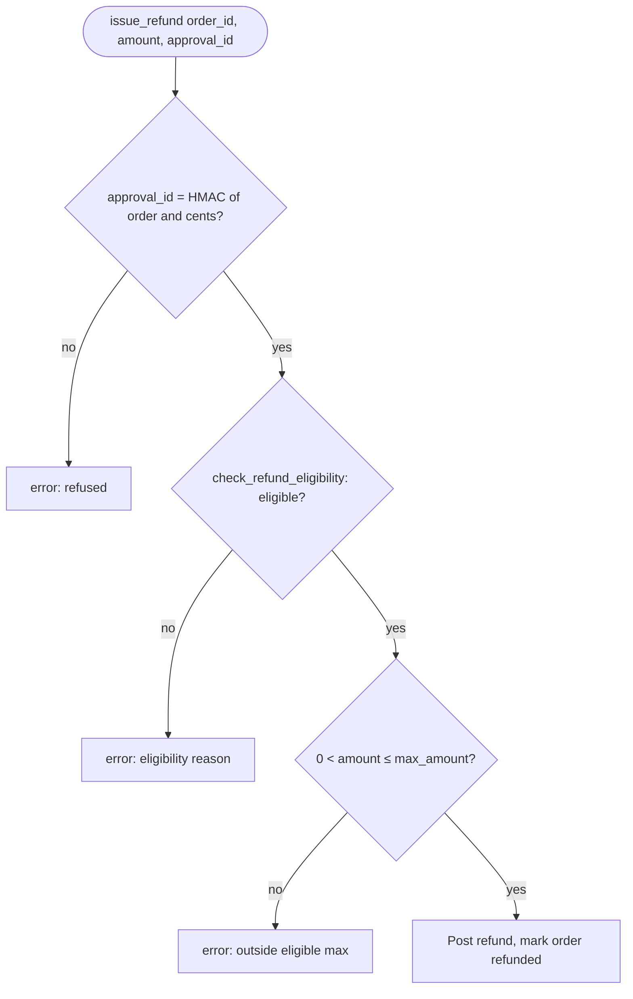

# mcp-server

TypeScript MCP tool server on `:8002`, speaking Streamable HTTP at `/mcp`. It owns the order, customer, and refund tools, for this agent and any other MCP client ([ADR 0003](../decisions/0003-mcp-as-shared-http-service.md)). Data is in-memory sample data.

Code: `apps/mcp-server/src/`. Tools in `create-server.ts`, data and eligibility in `data.ts`, approval check in `approval.ts`.

## Tools

| Tool | Kind | Input | Returns |
| --- | --- | --- | --- |
| `get_order` | read | `{order_id}` | Items, totals, status, shipping, refund flags |
| `get_shipping_status` | read | `{order_id}` | Status, carrier status, tracking, timestamps |
| `check_refund_eligibility` | read | `{order_id}` | `{eligible, reason, max_amount, prior_refund_id?}` |
| `get_customer` | read | `{customer_id}` | Name, email, recent order ids |
| `issue_refund` | write | `{order_id, amount, approval_id, reason?}` | Refund record `REF-xxxx`, `status: posted` |
| `escalate_to_human` | write | `{thread_id, summary}` | Echo only; nothing is stored |

Inputs are strict zod schemas. Every tool returns one text block of JSON; errors are `{"error": "..."}` in the same shape, so the model can read them.

## Sample data

| Order | Customer | State | Refund eligible |
| --- | --- | --- | --- |
| `ORD-1001` | `CUS-1` | Delivered, $49.99 | Yes, up to $49.99 |
| `ORD-1002` | `CUS-2` | In transit, $129.00 | No: in transit |
| `ORD-1003` | `CUS-1` | Delivered, $899.00 | No: outside return window |
| `ORD-1004` | `CUS-GUEST` | Delivered, $24.00 | No: already refunded |

Data is shared by every client and resets when the process restarts.

## Tool call

The agent opens a new session for every call. If MCP is down, the agent's client returns `{"error": ...}` to the model instead of raising.

## `issue_refund` guards

The server does not trust the client: even a buggy or malicious caller cannot invent an approval, over-refund, or refund an ineligible order. How the agent produces the signature is in [Human in the loop](../flows/human-in-the-loop.md).

## Config

Read from the process environment only.

| Variable | Default |
| --- | --- |
| `PORT`, `HOST` | `8002`, `0.0.0.0` |
| `APPROVAL_SECRET` | `dev-approval-secret`. Must match the agent |

Requests must carry a `Host` header of `localhost`, `127.0.0.1`, `mcp-server`, or `mcp`.

## Known gaps

- **MCP-TD-1** — Refund signatures fall back to a secret in source when `APPROVAL_SECRET` is unset.
- **MCP-TD-2** — Data is in memory and resets on restart; only four orders.
- **MCP-TD-3** — Return-window eligibility is a magic string, not date math.
- **MCP-TD-4** — Errors are not flagged `isError` at the protocol level.
- **MCP-TD-5** — Refunds are all-or-nothing per order, with no idempotency key.
- **MCP-TD-6** — `escalate_to_human` stores nothing and is never called.
- **MCP-TD-7** — Almost no tests, and no script runs them.

Decisions: [mcp-server](../decisions/service-decisions.md#mcp-server), [ADR 0003](../decisions/0003-mcp-as-shared-http-service.md).
