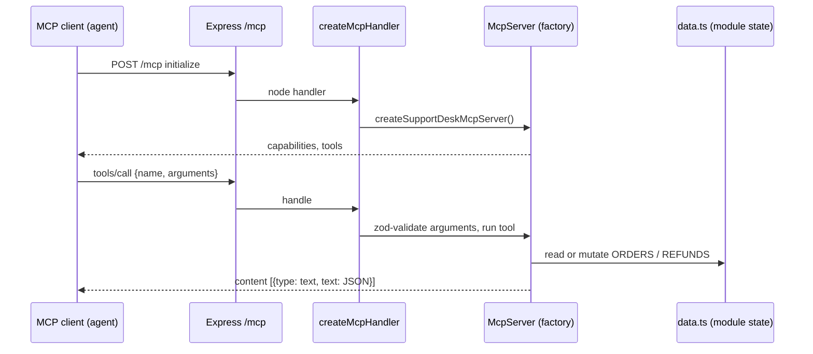
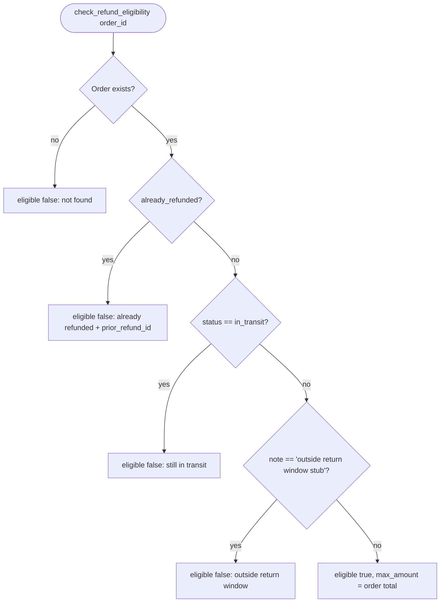
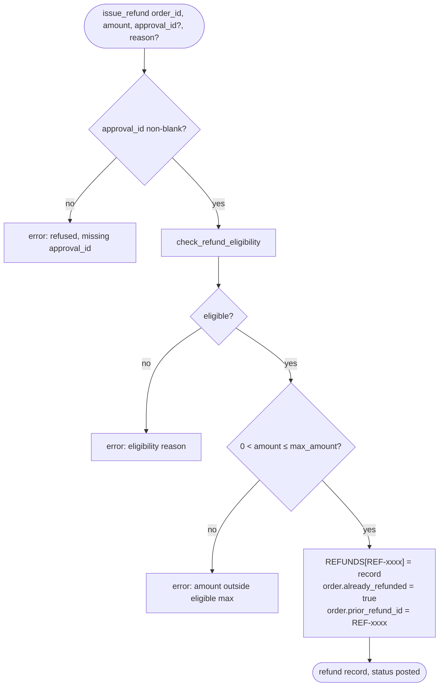

# mcp-server flows

## Tool call

The agent opens a new session for every tool call (initialize, call, close). Arguments that fail the zod schema are rejected by the SDK before the tool runs.

## Refund eligibility

All ineligible results have `max_amount: 0`.

## `issue_refund`

Because a posted refund sets `already_refunded`, a second call for the same order fails eligibility. That is the only protection against double refunds.

## `escalate_to_human`

Returns `{escalated: true, thread_id, summary, queue: "human-support-stub"}`. Nothing is stored or notified. The agent does not call it today.
