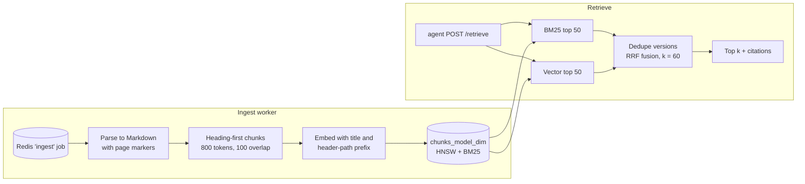

# rag

Python FastAPI service on `:8001` that owns the policy corpus: document versions, parsing, chunking, embeddings, hybrid search, grounded answers, and retrieval evals. The BullMQ ingest worker runs in the same process by default.

Code: `apps/rag/src/rag/`. Ingest in `ingest.py` and `worker.py`, parsing in `parse.py`, chunking in `chunking.py`, search in `retrieve.py`.

## Endpoints

| Method | Path | Caller | Does |
| --- | --- | --- | --- |
| GET | `/health` | ops | DB, embedding model and dim, active chunk table, worker flag |
| POST | `/documents/reserve` | api | Creates the next version row (`queued`) and returns its `storage_path` |
| GET | `/documents`, `/documents/{id}` | api | Document rows with `chunk_count` |
| POST | `/documents/{id}/status` | api | Marks a row failed when enqueue fails |
| POST | `/retrieve` | agent | `{query, top_k=5}`. Hybrid search; returns `documents`, `citations`, `usage` |
| POST | `/answer`, `/answer/stream` | — | Retrieve, then `MAIN_MODEL` answers with `[n]` citations (stream is SSE) |
| POST | `/evals/run` | dev | Golden-set retrieval metrics, optional answer scoring |

## CLI

Run from `apps/rag`:

```bash
poetry run rag-worker          # worker alone (set WORKER_ENABLED=false on the API)
poetry run rag-seed --ingest   # write docs/seed/* and evals/golden.json, then ingest them
poetry run rag-reindex         # re-embed after changing EMBEDDING_MODEL / EMBEDDING_DIM
poetry run rag-golden          # draft golden cases into evals/golden.generated.json
poetry run pytest
```

## Pipeline



- **Formats.** PDF, DOCX, HTML, Markdown, and text are parsed to Markdown with `<!-- page:N -->` markers, so one chunker handles all of them. URLs are fetched with a plain HTTP GET; public Google Docs links are exported as PDF.
- **Chunks.** A chunk never crosses a heading, so each has one header path for precise citations. The embedded text is prefixed with `[Title] › header path (p. N)`.
- **Hybrid search.** BM25 and vector search each return 50 candidates, fused with reciprocal rank fusion. No reranker, no score threshold.
- **Versions.** Re-uploading the same file name or URL creates a new version. Identical text across versions is returned once, from the newest.
- **One table per embedding model.** `chunks_<model>_<dim>`. After changing the model, run `rag-reindex` or search returns nothing.

The upload path from the browser is in [Document ingest](../flows/document-ingest.md).

## Config

Reads the root `.env`, then `apps/rag/.env` (later wins).

| Variable | Default |
| --- | --- |
| `DATABASE_URL`, `REDIS_URL` | local Postgres and Redis |
| `UPLOADS_DIR` | `<repo>/docs/uploads` |
| `OPENROUTER_API_KEY` | required |
| `MAIN_MODEL`, `JUDGE_MODEL` | `anthropic/claude-haiku-4.5`, `openai/gpt-4.1` |
| `EMBEDDING_MODEL`, `EMBEDDING_DIM` | `openai/text-embedding-3-small`, `1536` |
| `CHUNK_TOKENS`, `CHUNK_OVERLAP` | `800`, `100` |
| `CANDIDATE_K`, `RRF_K` | `50`, `60` |
| `LANGSMITH_API_KEY`, `LANGSMITH_PROJECT` | —, `support-rag` |
| `WORKER_ENABLED` | `true` |

## Evals

`apps/rag/evals/golden.json` has 23 cases, one per section of the 7 seed documents. It is generated by the same `seed.py` that writes the corpus, so each question maps to a known `title` and `header_path`.

```bash
poetry run rag-seed --ingest   # same corpus for comparable numbers
curl -XPOST localhost:8001/evals/run -H 'content-type: application/json' -d '{"answer":true,"judge":true}'
```

Reports hit@5, recall@5, precision@5, MRR@10, MAP@10, and nDCG@10. With `answer`, also latency, tokens, and cost. With `judge`, faithfulness, groundedness, answer relevance, and context relevance (Ragas, with a JSON-judge fallback).

## Known gaps

- **RAG-TD-1** — No reranker and no weak-retrieval refusal; off-topic questions get loosely related context. No unanswerable eval cases.
- **RAG-TD-4** — Sections whose text changed between versions stay searchable in both versions.
- **RAG-TD-5** — Parsing is synchronous and blocks the API when the worker runs in-process.
- **RAG-TD-6** — No embedding or retrieval cache.
- **RAG-TD-7** — Ingest embeds a whole document in one request and inserts row by row.
- **RAG-TD-8** — Reindex loads everything into memory and never drops old tables.
- **RAG-TD-9** — Will not boot if Postgres is not up yet.
- **RAG-TD-10** — Status endpoint accepts any string; retrying documents look `queued`.
- **RAG-TD-11** — Approximate character offsets; `/answer/stream` keeps running after the client disconnects.

Decisions: [rag](../decisions/service-decisions.md#rag), [ADR 0005](../decisions/0005-paradedb-single-postgres.md), [ADR 0006](../decisions/0006-bullmq-ingest-queue.md).
