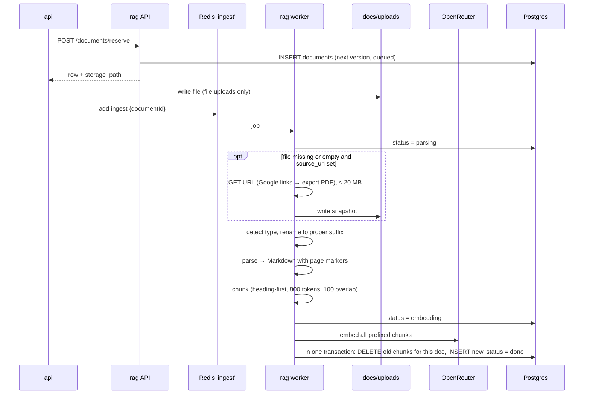
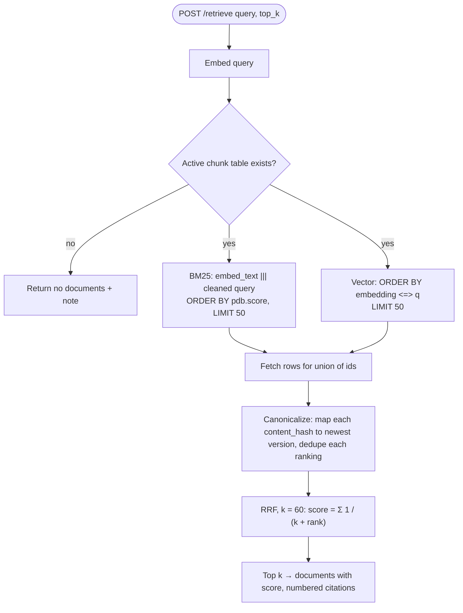

# rag flows

## Ingest

On an exception the worker sets `queued` with `attempt n/m: <error>` if retries remain, or `failed` on the last attempt, then re-raises so BullMQ retries with backoff. Ingest is safe to retry because it replaces the document's chunks.

### Versions

Reserving the same `source_key` (file name or URL) again creates version `n+1` with its own row and folder. Every version stays in the index. At search time, chunks with identical `content_hash` are collapsed to the newest version. Chunks whose text changed between versions are all kept.

### Types

| Kind | Detected by | Parsed by | Pages |
| --- | --- | --- | --- |
| pdf | `%PDF` header, `.pdf`, `application/pdf` | `pypdf` per page | Real pages |
| docx | `.docx`, Word content type, or zip with `word/` | `python-docx`; `Heading N` styles become `#` | Explicit page breaks and rendered breaks |
| html | `.html/.htm`, `text/html`, or `<html` in the first 800 chars | BeautifulSoup (drop script/style) → `markdownify`; `<title>` becomes `#` if needed | Page 1 |
| md | `.md`, `text/markdown` | As-is | Page 1 |
| txt | Everything else | As-is | Page 1 |

URL fetching is a plain HTTP GET with redirects. No JavaScript rendering, no crawling. Public Google Docs, Sheets, and Slides links are rewritten to their PDF export URL; a redirect to `accounts.google.com` fails as "not public". Notion is out of scope.

### Chunks

1. Split the Markdown into sections at every heading. The header path is the heading stack joined with ` > ` (`Document` if there are no headings). A chunk never crosses a heading.
2. Within a section, split on blank lines. Paragraphs over the limit are cut by tokens.
3. Pack paragraphs up to `CHUNK_TOKENS` (cl100k tokens). Each new chunk starts with the last `CHUNK_OVERLAP` tokens of the previous one (overlap is capped at half the size).
4. The document title is the first `#` heading, else the file stem.
5. The embedded text (`embed_text`) is `[Title] › header path (p. N or p. N-M)` followed by the chunk.

## Retrieve

The BM25 query is the input with punctuation other than `.` and `-` replaced by spaces. There is no reranker and no score threshold.

## Answer

`/answer` and `/answer/stream` call retrieve, then:

- With no documents: return the refusal "I don't have a policy document that covers that." with `refused: true`.
- Otherwise: build numbered context blocks (`[n] embed_text` plus a metadata line with version, pages, source, type), send them in the system prompt to `MAIN_MODEL` with `temperature 0` and streaming, and emit `token` events followed by `done` with the answer, citations, and usage.

Usage combines embedding and chat tokens. Cost uses OpenRouter's reported `cost` when both parts have it, otherwise the `*_USD_PER_MILLION` rates, otherwise `null`.

## Reindex

After changing `EMBEDDING_MODEL` or `EMBEDDING_DIM`, `poetry run rag-reindex`:

1. Picks the source table: the active table if it exists, else the first other `chunks_*` table.
2. Reads every chunk, re-embeds `embed_text` in batches of 64.
3. Creates the target table and indexes, deletes its rows, and inserts all chunks in one transaction.

Old tables are not dropped.

## Evals

Golden questions live in `evals/golden.json`, one per section of the seed corpus (`docs/seed`). A retrieved chunk is relevant when its title and header path match the case label. If nothing in the top 10 matches, the judge model can mark relevance for that case.

`POST /evals/run` reports:

| Group | Metrics |
| --- | --- |
| Retrieval | hit@5, recall@5, precision@5, MRR@10, MAP@10, nDCG@10 |
| Answers (`answer: true`) | Faithfulness, groundedness, answer relevance, context relevance (Ragas; a single JSON judge with `JUDGE_MODEL` when Ragas cannot score a case) |
| Runtime | Time to first token, end-to-end latency, tokens, cost |

A LangSmith experiment is written when `LANGSMITH_API_KEY` is set. `rag-golden` writes `golden.generated.json` for review using Ragas testset generation when available; it never overwrites `golden.json`.
