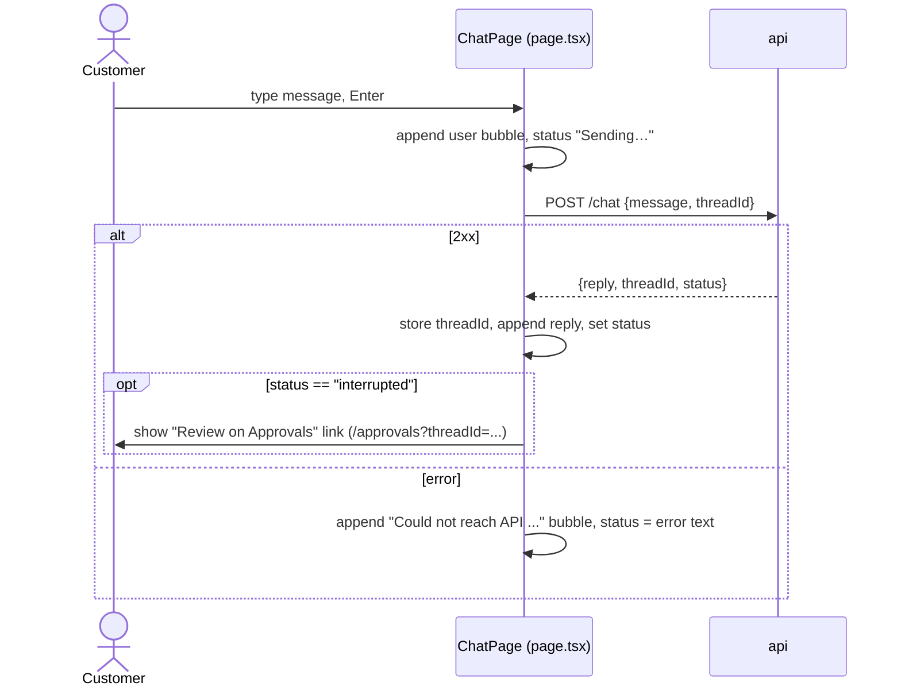
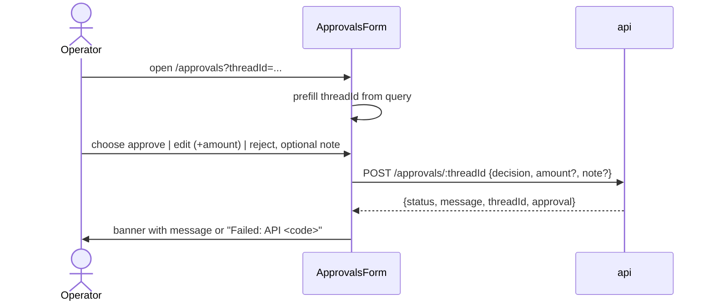
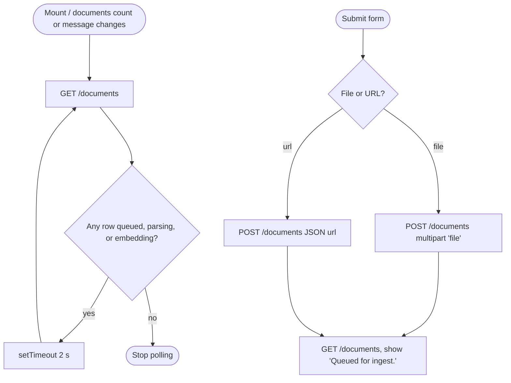

# web flows

## Chat

- The first message sends `threadId: null`. The agent creates `thread-<hex>` and every later message reuses it.
- Messages and the thread id live only in React state. A page reload starts a new thread on the client, though the old thread still exists in the agent's checkpoint.
- Email confirmation happens in this same chat: the agent asks for **yes** or **no**, and the next message resumes the interrupt.
- A pending refund shows `status: "interrupted"` and the Approvals link. Further chat messages get a "waiting for operator approval" reply until it is resolved.

## Approvals

The form does not load or show the refund draft (order, amount, eligibility). The operator sees only what the chat transcript showed.

## Documents

Client-side checks: exactly one of file or URL. File input accepts `.pdf,.docx,.md,.txt,.html,.htm`. The 20 MB limit is enforced by api.
